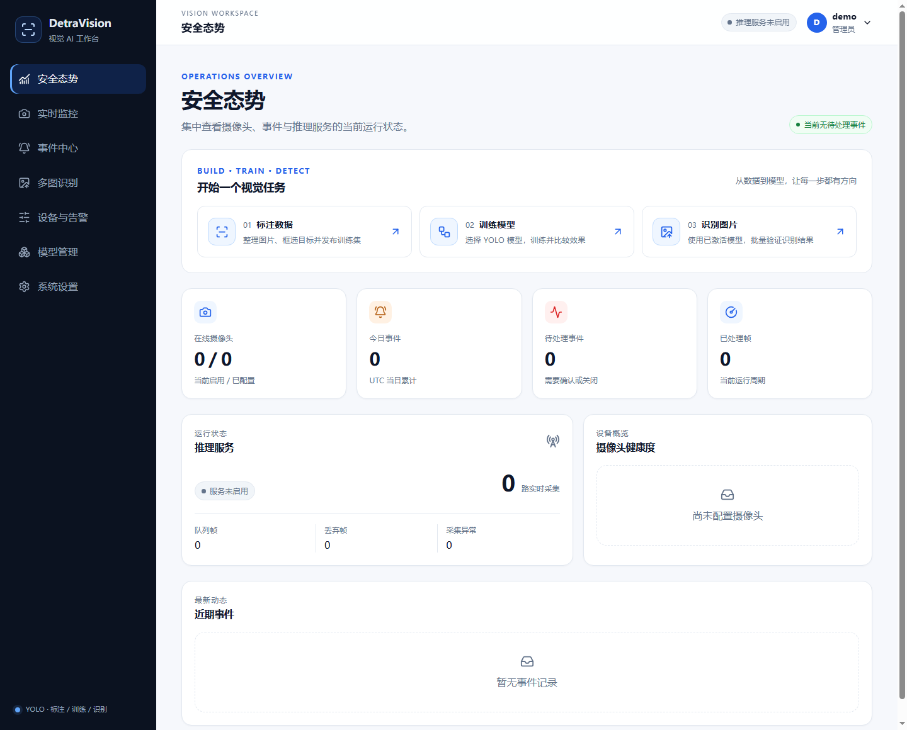

# DetraVision

**An all-in-one YOLO platform for data annotation, model training, and object detection.**

English · [简体中文](README.zh-CN.md) · [Documentation](docs/README.md) · [Roadmap](docs/roadmap.md#english)

Move from annotated images to deployed models in one web workspace: version datasets, train locally, evaluate experiments, run batch image inference, and detect objects in live video. Custom bounding-box classes are supported, with industrial safety inspection as the focus for deeper development.

```text
Prepare images → Annotate & publish → Train YOLO → Evaluate & compare → Activate → Detect
```



## Core capabilities

| Capability | What you can do |
|---|---|
| Annotation & datasets | Draw custom-class boxes, validate labels, and publish traceable dataset versions |
| Training & evaluation | Train YOLO locally, use basic/advanced settings, stop/resume runs, and compare per-class metrics |
| Inference & events | Process image batches and multiple RTSP streams, configure ROIs, and acknowledge/close events |
| Models & deployment | Register candidates, warm up and activate models, export ONNX / TensorRT, and deploy locally or with containers |

Helmet violations, fire, and smoke are built-in examples. Training and inference support other classes; configurable live alert rules for arbitrary classes remain on the roadmap.

## Quick start

Requires **Python 3.12+ and Node.js 24.x** on Windows or Linux.

```bash
git clone https://github.com/ThinkMo/detravision.git
cd detravision
```

Windows:

```powershell
.\start.cmd
```

Linux:

```bash
chmod +x start.sh
./start.sh
```

Open **http://127.0.0.1:8000/**. In development, an empty database without a configured initial password uses `admin / admin123456`; changing the password is mandatory on first login. You can explore the workspace without a model. Inference and training require model weights and datasets.

See the [deployment and usage guide (Chinese)](docs/operations.md) and [launcher guide (Chinese)](docs/local-start.md) for installation, configuration, GPU setup, Docker, and troubleshooting.

## TODO

- **Automatic annotation — research:** compare domain-model prelabeling, text-prompted bootstrapping, and quality review.
- **Cloud training — planned:** progressively support Alibaba Cloud, Volcengine, Tencent Cloud, and Huawei Cloud with consistent job and artifact management.

See the [roadmap](docs/roadmap.md#english) for scope, milestones, and status. These plans are not available features or delivery-date commitments.

## Documentation & contributing

| Resource | Contents |
|---|---|
| [Deployment & usage (Chinese)](docs/operations.md) | Configuration, Docker, permissions, architecture, development checks, and limitations |
| [Annotation guide (Chinese)](docs/dataset-annotation-guide.md) | Dataset versions, manual annotation, and publishing |
| [Training guide (Chinese)](docs/training-guide.md) | Settings, evaluation, experiment comparison, and export |
| [Annotation research (Chinese)](docs/research/2026-10-15-automatic-annotation-survey.md) | Candidate approaches and validation methodology |
| [Licensing](docs/licensing.md#english) | AGPLv3 and dependency license information |
| [Contributing](CONTRIBUTING.md#english) | Issues, development checks, and pull requests |

Contributions and real-world use-case feedback are welcome through [Issues](https://github.com/ThinkMo/detravision/issues) and pull requests.

## License

[GNU AGPLv3](LICENSE), SPDX: `AGPL-3.0-only`. Modified versions offered to users over a network must provide access to Corresponding Source as required by Section 13. Check Ultralytics, model weights, and other dependencies separately; see [licensing](docs/licensing.md#english).

Copyright © 2026 [ThinkMo](https://github.com/ThinkMo).
